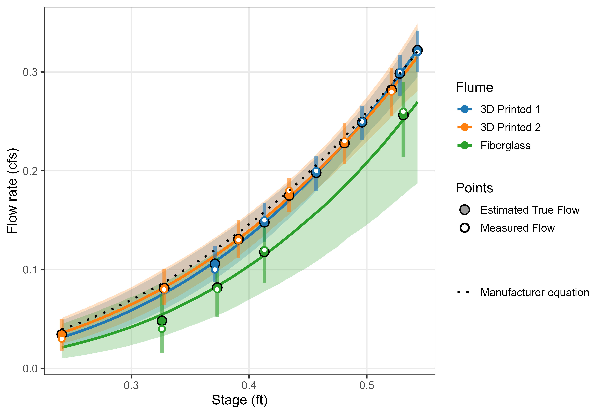

# 3D‑Printed Trapezoidal Flume Calibration and Bayesian Sensitivity Analysis  
**Authors:** AJ Brown and Emmanuel Deleon (Agricultural Water Quality Program, Colorado State University)  
**Collaborators:** Daniel White (CSU Hydraulics Lab), Perry Cabot, Erik Wardle  
**Project Year:** 2025‑2026  

---

## Overview  

This repository documents the calibration and uncertainty analysis for CSU’s **3D‑printed trapezoidal flume**, developed as a low‑cost, field‑ready alternative to commercial fiberglass units.  
Hydraulic testing was performed at the **CSU Hydraulics Laboratory**, and a **hierarchical Bayesian model** was used to jointly estimate the stage–discharge relationships and their associated measurement uncertainties.  

The Bayesian approach allows direct inference on the *true* (latent) discharge for each flume while accounting for known error sources—depth measurement accuracy, flow‑meter precision, and infiltration loss.  



---

## Research Objectives  

| Objective | Description |
|------------|-------------|
| **1. Quantify Measurement Uncertainty** | Incorporate gauge, flow‑meter, and infiltration errors directly into the Bayesian likelihood. |
| **2. Compare Flume Calibration Curves** | Estimate per‑flume power‑law parameters (*a*, *b*) and credible intervals, and compare against the manufacturer’s equation. |
| **3. Propagate Full Uncertainty** | Generate posterior credible intervals for the latent “true” flow and predicted discharges over the operational range. |
| **4. Evaluate 3D vs. Fiberglass Performance** | Test whether 3D‑printed flumes reproduce the manufacturer’s hydraulic behavior within 95 % credible intervals. |

---

## Bayesian Modeling Approach  

A hierarchical Bayesian model of the form  
\[ Q_{true,i} = a_j H_i^{b_j} + \epsilon_{proc,j}, \quad Q_{obs,i} \sim \text{Normal}(Q_{true,i}, \sigma_{meas}) \]  
was fit using the `ulam()` function from the **rethinking** R package.  
Each flume \(j\) had its own rating‑curve parameters (*a*, *b*) and process variance \(\sigma_{proc,j}\), while additive and proportional error terms modeled infiltration and flow‑meter precision.  

The model produces **posterior credible intervals**—probability statements about parameter values given the data—rather than frequentist confidence intervals.  

---

## Posterior Parameter Estimates  

| Parameter | Description | 3D Printed 1 | 3D Printed 2 | Fiberglass |
|------------|-------------|--------------|---------------|-------------|
| **a** | Scale coefficient (*Q = a Hᵇ*) | 1.88 (1.35 – 2.42) | 1.64 (1.21 – 2.15) | 1.85 (0.98 – 2.93) |
| **b** | Exponent controlling curve steepness | 2.86 (2.41 – 3.26) | 2.67 (2.29 – 3.06) | 3.10 (2.32 – 3.79) |
| **σₚᵣₒ꜀** | *Process variability* — small flow fluctuations at constant depth | 0.009 (0.001 – 0.027) | 0.008 (0.001 – 0.023) | 0.024 (0.002 – 0.071) |
| **σ_Q,add** | *Flume infiltration error* — additive discharge loss | 0.012 (0.006 – 0.022) | 0.012 (0.006 – 0.022) | 0.019 (0.008 – 0.040) |
| **cv_Q** | *Flow‑meter precision* — proportional (% of reading) error shared by all flumes | 0.00022 (0.00009 – 0.00044) | 0.00022 (0.00009 – 0.00044) | 0.00022 (0.00009 – 0.00044) |

Values are posterior means with 95 % credible intervals.

---

## Generated Stage–Discharge Predictions  

| Depth (ft) | 3D Printed 1 | 3D Printed 2 | Fiberglass | Manufacturer Eq. |
|-------------|--------------|--------------|-------------|------------------|
| 0.1 | 0.003 (0.001 – 0.007) | 0.003 (0.002 – 0.008) | 0.001 (0 – 0.007) | 0.004 |
| 0.2 | 0.018 (0.011 – 0.032) | 0.022 (0.014 – 0.034) | 0.012 (0.005 – 0.030) | 0.024 |
| 0.3 | 0.059 (0.044 – 0.080) | 0.065 (0.049 – 0.082) | 0.042 (0.024 – 0.072) | 0.069 |
| 0.4 | 0.134 (0.116 – 0.155) | 0.139 (0.122 – 0.157) | 0.104 (0.070 – 0.140) | 0.146 |
| 0.5 | 0.255 (0.237 – 0.270) | 0.253 (0.229 – 0.274) | 0.209 (0.146 – 0.253) | 0.259 |
| 0.6 | 0.430 (0.374 – 0.476) | 0.412 (0.353 – 0.473) | 0.367 (0.251 – 0.463) | 0.415 |
| 0.7 | 0.670 (0.534 – 0.801) | 0.621 (0.498 – 0.768) | 0.591 (0.366 – 0.827) | 0.618 |
| 0.8 | 0.983 (0.726 – 1.252) | 0.887 (0.671 – 1.165) | 0.896 (0.502 – 1.380) | 0.872 |

The table reports posterior median flow rates with 95 % credible intervals, compared to the manufacturer’s empirical equation.  
All three flumes closely reproduce the manufacturer’s relationship across the operating range, with increasing uncertainty beyond 0.6 ft where calibration data were sparse.

---

## Repository Structure  

```
3d-flume-uncertainty-analysis/
│
├── code/
│   ├── bayesflume.r                 # Hierarchical Bayesian model definition and fitting
│   ├── flume-analysis.py            # Legacy Python calibration script
│   ├── flume-montecarlo.py          # Monte Carlo uncertainty propagation (optional)
│   ├── flume-analysis-with-band.py  # Comparison of band vs. point estimates
│   └── main.py                      # Entry script for Python analysis
│
├── data/
│   └── flume_data.csv               # Raw calibration data from CSU Hydraulics Lab
│
├── docs/
│   ├── large_60-degree-v_trapezoidal_flume_discharge_table.pdf
│   └── Trapezoidal Flume Testing.pdf
│
└── output/
    ├── flume_posterior_curves_final.jpg        # Posterior plot shown above
    ├── flume_generated_numeric.csv             # Predicted flows with 95 % CIs
    ├── flume_model_3_precis.csv                # Model parameter summaries
    ├── flume_montecarlo_band.png               # Optional Monte Carlo comparison
    └── flume_stage_discharge_with_errors.png   # Earlier frequentist comparison
```

---

## Key Takeaways  

- All flumes perform comparably within overlapping 95 % credible intervals, with both 3D-printed versions closely matching the manufacturer’s reference curve across most of the tested range.
- The fiberglass flume had a much larger 95% CI, most likely due to having less sample data for calibration.
- At higher stages (> 0.6 ft), uncertainty widens due to extrapolation beyond the densest calibration region, but no systematic bias is evident.
- These results suggest the 3D-printed designs reproduce the manufacturer’s hydraulic response within experimental uncertainty, supporting their use for comparable discharge measurement applications.
- The Bayesian approach made a significant difference in our interpretation, by allowing measurement error to propagate estimates of True flow, and adjusting our flow curves appropriately.

---

## References
- McElreath R (2024). rethinking: Statistical Rethinking book package. R package version 2.42, https://github.com/staffanbetner/rethinking.
- McElreath, R. (2020). Statistical Rethinking: A Bayesian Course with Examples in R and STAN (2nd ed.). Chapman and Hall/CRC. https://doi.org/10.1201/9780429029608


